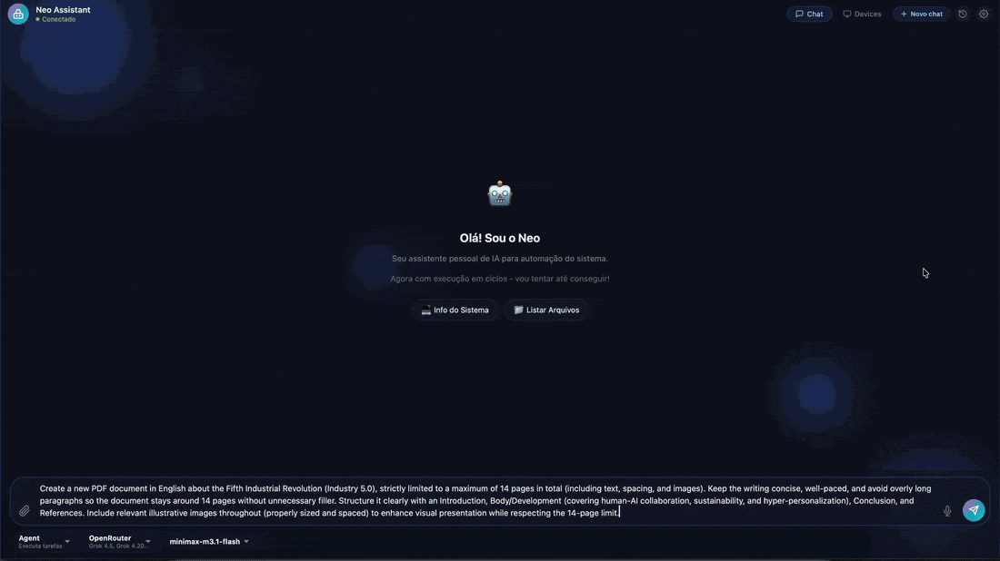
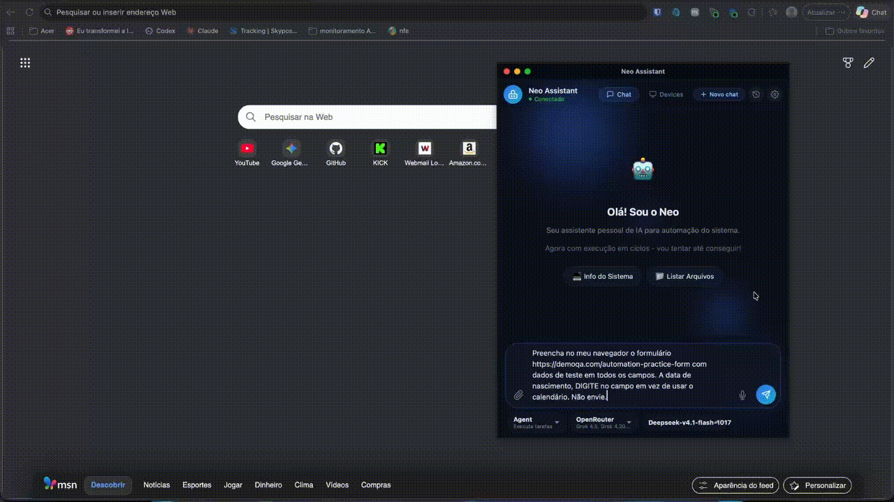
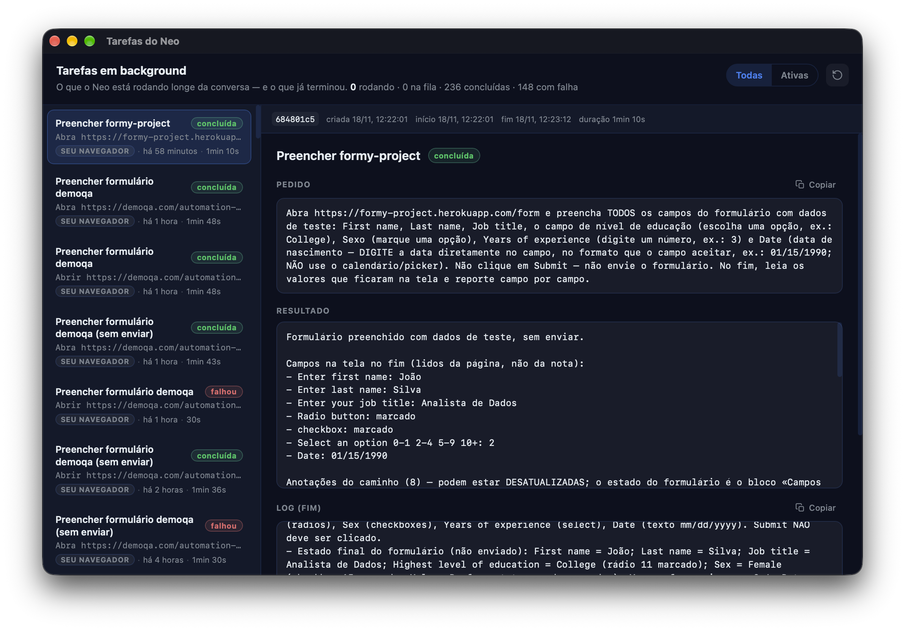
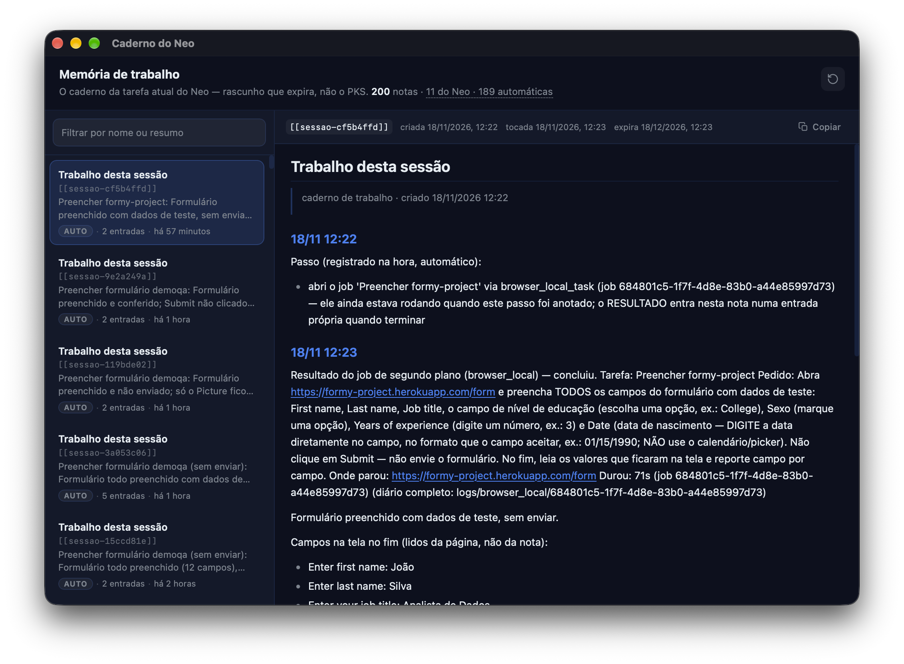
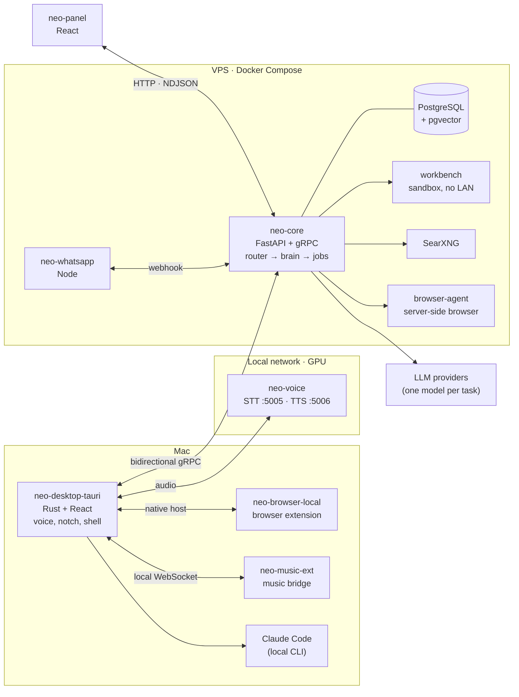

<p align="center"><a href="README.md">Português</a> · <strong>English</strong></p>

<h1 align="center">Neo</h1>

<p align="center">
  <strong>A personal assistant I hand work to: researching, writing, building files, remembering and acting on the Mac. By voice, chat or WhatsApp.</strong>
</p>

<p align="center">
  Python · FastAPI · gRPC · Rust/Tauri · React · TypeScript · PostgreSQL + pgvector · Docker
</p>

<p align="center">
  4,701 Python tests · 156 Rust tests · in daily use since February 2026
</p>

<p align="center">
  <a href="evals/README.md"><strong>📊 Evaluations, model comparisons and case studies (in Portuguese) →</strong></a>
</p>

<!-- MEDIA 6: link to the support demo video. -->

<p align="center">
  
  <br>
  <sub>One request with a 14-page limit, six minutes of work in the server's sandbox (the wait is sped up in the GIF): Neo researches the sources, picks licensed images from Wikimedia Commons, builds the PDF within the limit and checks it page by page before delivering. (Interface and replies in Portuguese.)</sub>
</p>

---

Neo is a personal project I use every day. It takes requests by voice, chat or WhatsApp and decides what to do: answer, remember something, run a long task in a sandbox, use the browser or run a command on the Mac, always asking for approval when the action is sensitive. Research, documents and spreadsheets run on the server; the browser is one more tool, for what can only be done in an open page, such as a form or a site you are logged into.

The hard part of an assistant like this is not calling a model. It is deciding **what the model may decide on its own and what has to be code**, measuring every change, and not letting a web page take control of the assistant. This repository shows those decisions.

The code comments and the design docs are in Portuguese.

## What Neo does

- **Does the work and delivers the file.** Searches the web, writes and builds PDFs, spreadsheets and Word documents in a Docker sandbox with no access to the local network, checks the result before delivering and says what remained uncertain. Reads long PDFs with subagents, transcribes video and runs OCR.
- **Remembers you.** A personal knowledge graph (PKS) in Postgres, semantic retrieval over past conversations (pgvector) and a working notebook for long tasks.
- **Runs long tasks in the background.** What takes a while becomes a job: the conversation goes on and Neo reports back when it is done.
- **Talks by voice on the Mac.** Wake word ("ei Neo"), live mode with barge-in ("pare" stops it), speech-to-text (Parakeet) and text-to-speech running on a GPU in the local network, and a native "notch" in Swift showing the state.
- **Acts on the Mac with approval.** Local commands go through a risk policy: what is safe runs, what is not asks for confirmation.
- **Uses the browser you are looking at, when it needs to.** An extension (a fork of [open-browser-use](https://github.com/iFurySt/open-browser-use)) gives Neo the tabs of your browser, with a timeline panel and a STOP button. It reads several tabs in parallel, asks when it needs you and keeps passwords in its own vault.
- **Delegates code.** Opens a Claude Code session on the Mac, follows it and brings back the report.
- **And more:** WhatsApp, scheduling (cron), smart home (Home Assistant), music (Spotify/YouTube) and personal finance.

<p align="center">
  
  <br>
  <sub>When a request needs an open page, it becomes a job in the browser you are looking at: Neo fills in the form field by field, narrates each step on the timeline and does not click submit. (UI in Portuguese.)</sub>
</p>

<table>
  <tr>
    <td width="50%"></td>
    <td width="50%"></td>
  </tr>
  <tr>
    <td><sub><strong>Tasks.</strong> What runs away from the conversation: request, result, duration and log of each job, including the failed ones.</sub></td>
    <td><sub><strong>Working notebook.</strong> The scratchpad of the current task: each step is noted as it happens, and the job's result is added when it finishes.</sub></td>
  </tr>
</table>

## Architecture



Every request first goes through a **cheap classifier** that picks the track: answer, use a server tool, act on the Mac, trigger a skill or build a plan. Almost everything lands in the **brain**, an LLM loop with tools. A long task becomes a **job**, which reports back when it finishes. The full path of a request is in the [technical map](neo-core/docs/mapa-tecnico-neo-core.md), and the router's in [this diagram](neo-core/docs/mapa-intent-router.svg).

## Engineering decisions

**1. Whatever is dangerous, expensive or easy to get wrong is decided by code, not by the model.**
Choices that a model flips from one turn to the next (where a request goes, whether it may run, when to stop) live in code, with tests. The model decides what is language. → [`core/router/intent_router.py`](neo-core/core/router/intent_router.py), [`core/authority/`](neo-core/core/authority)

**2. Text that came from outside does not command the assistant.**
Each turn records who asked and what came from third parties (a web page, an email, pasted text). A sensitive action requested in a "tainted" turn is blocked by a gate in code. A warning in the prompt was not enough: it was tested, and the model still followed the injection. → [`core/authority/`](neo-core/core/authority), [gate design](neo-core/docs/release-request-plan.md)

**3. Measure before changing.**
A prompt or model change is measured with the real production request, resent to the same model. A new router bug becomes a case in the golden set, not an example in the prompt: an example costs tokens on every message, a test case only costs during the eval. → [evaluations](evals/README.md), [`scripts/eval_router.py`](neo-core/scripts/eval_router.py)

**4. Risky features ship in shadow mode.**
Route authentication, the context register and the new memory ranking first ran observing and logging what they *would* have done, without blocking anything. They become rules only after being measured. → [authentication design](neo-core/docs/api-auth-plan.md)

**5. A live turn, not a turn with a deadline.**
What kills a turn is lack of progress, not the clock. A slow command on the Mac becomes a background task instead of freezing the conversation, and the answer streams out, one bubble per step.

**6. Latency and cost are solved by choosing the provider, not only the model.**
Pinning the inference provider tripled generation speed and kept the prefix cache. The reasoning budget adapts per model with the same math as TCP's retransmission timeout (moving average plus deviations, RFC 6298). → [`core/llm/teto_adaptativo.py`](neo-core/core/llm/teto_adaptativo.py)

## Evaluations

A few measurements, each comparing a single thing. The full list, with method and date, is in [**evals/README.md**](evals/README.md) (in Portuguese).

| Change (same model) | Before | After | n |
|---|---|---|---|
| Classifier prompt without repetition | 29,972 characters, 43/46 | **−37%, 43/46** | 46 cases |
| Brain turn (streaming + no reasoning + provider pin) | 71.5 s · first token in 13–40 s | **28.0 s · first token in 2.3–3.4 s** | replay of 6 rounds |
| Provider pin | 21.7 tok/s | **74–80 tok/s** | 4 per arm |
| Browser reading 3 listings (tabs in parallel) | 21 steps, 71 s | **5 steps, 39 s** | 2 real tasks |
| Warning when a download from a made-up URL fails | 0/5 search for the right URL | **5/5** | A/B, real request |

| Classifier, 30 real requests | p50 | p90 | Issue |
|---|---|---|---|
| GLM-5.3-flash | 3.4 s | 11.7 s | a provider ignores the reasoning budget |
| **MiniMax m3.1-flash** (in production) | **2.5 s** | **4.2 s** | 1/30 empty, the code retries |
| Haiku 5.5 | 2.6 s | 4.9 s | answered the user in 19/30 |

### Case studies

Real production problems, each with the diagnosis, the fix and the number that proved it (in Portuguese):

- [The "flash" model that thought for 20 seconds](evals/README.md#31-o-modelo-flash-que-pensava-por-20-segundos): 11–20 s → 0.8 s per call
- [An empty reply is not "nothing to say"](evals/README.md#32-resposta-vazia-não-é-nada-a-dizer): classifier from 13/46 to 44/46
- [An API that accepts the parameter and ignores it](evals/README.md#33-uma-api-que-aceita-o-parâmetro-e-ignora): 9 forced tool calls, zero calls made
- [The browser that read the same thing five times](evals/README.md#34-o-navegador-que-lia-a-mesma-coisa-cinco-vezes): 27 → 13 steps, answer delivered
- [The refusal that fed itself](evals/README.md#35-a-recusa-que-se-alimentava-sozinha): 11 → 0 refusals in 12 samples
- [The conversation that forgot its own answer](evals/README.md#36-a-conversa-que-esquecia-a-própria-resposta): 295 of 295 snippets discarded, five locks
- [The optimization that would have cost more](evals/README.md#37-a-otimização-que-sairia-mais-cara): measured first, not implemented
- [Guards measured on real messages](evals/README.md#38-guardas-que-leem-a-resposta-do-modelo-medidas-nas-mensagens-reais): 11 claims that slipped through

The same file has the comparisons: providers of the same model, reasoning on × off, how many tools to show the model, vision × text in the browser, and the voice engines (TTS, STT and wake word).

## The repository

| Folder | What it is | Stack |
|---|---|---|
| [`neo-core/`](neo-core) | The brain: router, tool loop, memory, jobs, skills, API | Python, FastAPI, gRPC, SQLModel, Alembic |
| [`neo-desktop-tauri/`](neo-desktop-tauri) | Mac app: chat, voice, wake word, notch, local shell, browser bridge | Rust (Tauri 2), React, TypeScript, Swift |
| [`neo-panel/`](neo-panel) | Web panel: conversations, logs, settings, devices | React, TypeScript |
| [`neo-browser-local/`](neo-browser-local) | Extension that gives Neo the tabs of your browser | JavaScript (MV3), MIT fork |
| [`neo-music-ext/`](neo-music-ext) | Bridge extension to play music in the browser | JavaScript (MV3) |
| [`neo-voice/`](neo-voice) | Speech-to-text and text-to-speech on a local GPU | Python, ONNX, PyTorch |
| [`neo-whatsapp/`](neo-whatsapp) | WhatsApp bridge | Node.js, wppconnect |
| [`neo-mobile/`](neo-mobile) | Phone app (draft) | Flutter |
| [`docker/`](docker), [`docker-compose.yml`](docker-compose.yml) | Sandbox, proxies, SearXNG, server-side browser | Docker |
| [`proto/`](proto) | gRPC contract between the core and the desktop | Protocol Buffers |
| [`evals/`](evals) | Measurements and how to reproduce them | |

## Running it

Neo is personal: it is tied to my LLM keys and my network. The core can be run locally:

```bash
cp .env.example .env          # fill in at least OPENROUTER_API_KEY and the passwords/tokens marked as required
docker compose up -d neo-postgres neo-core
cd neo-core && make migrate   # creates the tables
```

The web panel runs with `cd neo-panel && npm install && npm run dev`. The Mac app runs with `cd neo-desktop-tauri && npm install && npm start`, which builds the front end and opens `tauri dev`. Voice and the local browser depend on the infrastructure described in each folder's README.

Tests:

```bash
cd neo-core && uv run pytest                          # 4,701 tests, ~50 s
cd neo-desktop-tauri/src-tauri && cargo test          # 156 tests
```

## Status

In daily use. The core runs on a VPS with Docker Compose, and the Mac is the main client. Some parts are still in **shadow mode** (they log without blocking): route authentication, the context register and the v2 memory ranking. The design doc for each area, with what was measured and what is left, is in [`neo-core/docs/`](neo-core/docs) (in Portuguese).

## License

© 2026 Daniel Morais. The code is public for reading and evaluation, with all rights reserved ([LICENSE](LICENSE)). The [`neo-browser-local/`](neo-browser-local) folder is a fork of open-browser-use and keeps its original MIT license.

## Author

**Daniel Morais**, full stack developer · [LinkedIn](https://www.linkedin.com/in/danielmorais774) · [GitHub](https://github.com/danielmorais774)
