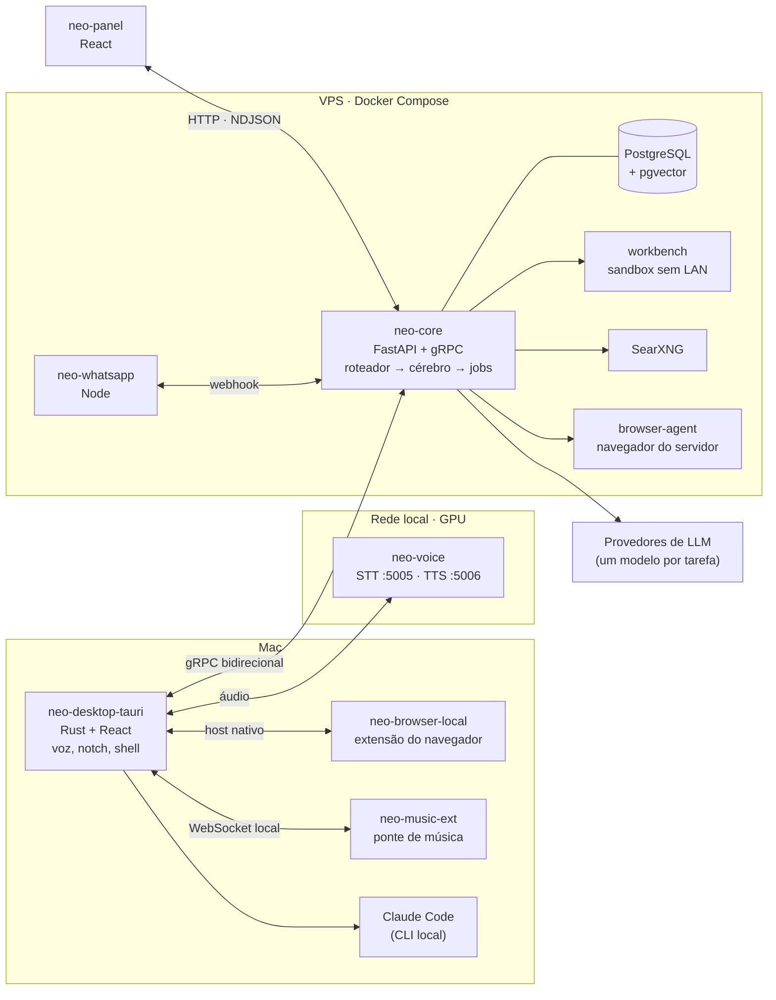

<p align="center"><strong>Português</strong> · <a href="README.en.md">English</a></p>

<h1 align="center">Neo</h1>

<p align="center">
  <strong>Um assistente pessoal que conversa, lembra e age: no Mac, no navegador que você está olhando e no WhatsApp.</strong>
</p>

<p align="center">
  Python · FastAPI · gRPC · Rust/Tauri · React · TypeScript · PostgreSQL + pgvector · Docker
</p>

<p align="center">
  4.701 testes em Python · 156 em Rust · em uso diário desde fevereiro de 2026
</p>

---

O Neo é um projeto pessoal que uso todo dia. Ele recebe pedidos por voz, chat ou WhatsApp e decide o que fazer: responder, lembrar de algo, rodar uma tarefa longa num sandbox, usar o navegador ou executar um comando no Mac, sempre com aprovação quando a ação é sensível.

O que dá trabalho num assistente assim não é chamar um modelo. É decidir **o que o modelo pode decidir sozinho e o que tem que ser código**, medir cada mudança e não deixar uma página da web mandar no assistente. Este repositório mostra essas decisões.

## O que o Neo faz

- **Conversa por voz no Mac.** Wake word ("ei Neo"), modo live com interrupção por "pare", STT (Parakeet) e TTS rodando numa GPU da rede local, e um "notch" nativo em Swift mostrando o estado.
- **Usa o navegador que você está olhando.** Uma extensão (fork do [open-browser-use](https://github.com/iFurySt/open-browser-use)) dá ao Neo as abas do seu navegador, com painel da linha do tempo e botão PARE. Ele lê várias abas em paralelo, pergunta quando precisa de você e guarda senhas num cofre próprio.
- **Lembra de você.** Grafo de conhecimento pessoal (PKS) no Postgres, recuperação semântica das conversas (pgvector) e um caderno de trabalho para tarefas longas.
- **Roda tarefas longas em segundo plano.** Jobs com sandbox Docker sem acesso à rede local, leitura delegada de PDFs, transcrição de vídeo, OCR e planilhas. Avisa quando termina.
- **Age no Mac com aprovação.** Comandos locais passam por uma política de risco: o que é seguro roda, o que não é pede confirmação.
- **Delega código.** Abre uma sessão do Claude Code no Mac, acompanha e traz o relatório.
- **E mais:** WhatsApp, agenda (cron), casa inteligente (Home Assistant), música (Spotify/YouTube) e finanças.

## Arquitetura



Todo pedido passa primeiro por um **classificador barato** que escolhe o trilho: responder, usar uma ferramenta do servidor, agir no Mac, acionar uma skill ou montar um plano. Quase tudo cai no **cérebro**, um laço de LLM com ferramentas. Tarefa longa vira **job**, que avisa quando termina. O caminho completo de um pedido está no [mapa técnico](neo-core/docs/mapa-tecnico-neo-core.md), e o do roteador, [neste diagrama](neo-core/docs/mapa-intent-router.svg).

## Decisões de engenharia

**1. O que é perigoso, caro ou fácil de errar é decidido por código, não pelo modelo.**
Escolha que o modelo troca de um turno para o outro (para onde vai o pedido, se pode executar, quando parar) mora no código, com teste. O modelo decide o que é linguagem. → [`core/router/intent_router.py`](neo-core/core/router/intent_router.py), [`core/authority/`](neo-core/core/authority)

**2. Texto que veio de fora não manda no assistente.**
Cada turno registra quem pediu e o que veio de terceiros (página da web, e-mail, texto colado). Uma ação sensível pedida num turno "contaminado" é barrada por um portão em código. Um aviso no prompt não bastou: foi testado e o modelo seguia a injeção mesmo assim. → [`core/authority/`](neo-core/core/authority), [plano do portão](neo-core/docs/release-request-plan.md)

**3. Medir antes de mudar.**
Mudança de prompt ou de modelo é medida com o request real de produção, reenviado ao mesmo modelo. Bug novo do roteador vira caso no golden set, não exemplo no prompt: exemplo custa token em toda mensagem, e caso de teste só custa no eval. → [avaliações](evals/README.md), [`scripts/eval_router.py`](neo-core/scripts/eval_router.py)

**4. Funcionalidade arriscada entra em modo sombra.**
Autenticação das rotas, registro de contexto e o novo ranking da memória rodaram primeiro observando e registrando o que *teriam* feito, sem barrar nada. Só viram regra depois de medidos. → [plano de autenticação](neo-core/docs/api-auth-plan.md)

**5. Turno vivo, não turno com prazo.**
O que derruba um turno é a falta de progresso, não o relógio. Comando lento no Mac vira tarefa em segundo plano em vez de travar a conversa, e a resposta sai em streaming, uma bolha por etapa.

**6. Latência e custo se resolvem na escolha do provedor, não só do modelo.**
Fixar o provedor de inferência triplicou a velocidade de geração e manteve o cache de prefixo. O teto de raciocínio se ajusta por modelo com a mesma conta do timeout do TCP (média móvel + desvios, RFC 6298). → [`core/llm/teto_adaptativo.py`](neo-core/core/llm/teto_adaptativo.py)

## Avaliações

Algumas medições, cada uma comparando uma coisa só. A lista completa, com método e data, está em [**evals/README.md**](evals/README.md).

| Mudança (mesmo modelo) | Antes | Depois | n |
|---|---|---|---|
| Prompt do classificador sem repetição | 29.972 caracteres, 43/46 | **−37%, 43/46** | 46 casos |
| Turno do cérebro (stream + sem raciocínio + pin) | 71,5 s · 1º token em 13–40 s | **28,0 s · 1º token em 2,3–3,4 s** | replay de 6 rounds |
| Pin de provedor | 21,7 tok/s | **74–80 tok/s** | 4 por braço |
| Navegador lendo 3 anúncios (abas em paralelo) | 21 passos, 71 s | **5 passos, 39 s** | 2 tarefas reais |
| Aviso quando um download de URL inventada falha | 0/5 buscam a URL certa | **5/5** | A/B, request real |

| Classificador, 30 pedidos reais | p50 | p90 | Problema |
|---|---|---|---|
| GLM-5.3-flash | 3,4 s | 11,7 s | provedor ignora o teto de raciocínio |
| **MiniMax m3.1-flash** (em produção) | **2,5 s** | **4,2 s** | 1/30 vazio, o código repete |
| Haiku 5.5 | 2,6 s | 4,9 s | respondeu ao usuário em 19/30 |

### Estudos de caso

Problemas reais de produção, cada um com o diagnóstico, a correção e o número que provou a correção:

- [O modelo "flash" que pensava por 20 segundos](evals/README.md#31-o-modelo-flash-que-pensava-por-20-segundos): 11–20 s → 0,8 s por chamada
- [Resposta vazia não é "nada a dizer"](evals/README.md#32-resposta-vazia-não-é-nada-a-dizer): classificador de 13/46 para 44/46
- [Uma API que aceita o parâmetro e ignora](evals/README.md#33-uma-api-que-aceita-o-parâmetro-e-ignora): 9 ferramentas obrigatórias, zero chamadas
- [O navegador que lia a mesma coisa cinco vezes](evals/README.md#34-o-navegador-que-lia-a-mesma-coisa-cinco-vezes): 27 → 13 passos, com a resposta entregue
- [A recusa que se alimentava sozinha](evals/README.md#35-a-recusa-que-se-alimentava-sozinha): 11 → 0 recusas em 12 amostras
- [A conversa que esquecia a própria resposta](evals/README.md#36-a-conversa-que-esquecia-a-própria-resposta): 295 de 295 trechos descartados, cinco travas
- [A otimização que sairia mais cara](evals/README.md#37-a-otimização-que-sairia-mais-cara): medida antes e não implementada
- [Guardas medidas nas mensagens reais](evals/README.md#38-guardas-que-leem-a-resposta-do-modelo-medidas-nas-mensagens-reais): 11 alegações que passavam batido

No mesmo arquivo há também os comparativos: provedores do mesmo modelo, raciocínio ligado × desligado, quantas ferramentas mostrar ao modelo, visão × texto no navegador e os motores de voz (TTS, STT e wake word).

## O repositório

| Pasta | O que é | Stack |
|---|---|---|
| [`neo-core/`](neo-core) | O cérebro: roteador, laço com ferramentas, memória, jobs, skills, API | Python, FastAPI, gRPC, SQLModel, Alembic |
| [`neo-desktop-tauri/`](neo-desktop-tauri) | App do Mac: chat, voz, wake word, notch, shell local, ponte do navegador | Rust (Tauri 2), React, TypeScript, Swift |
| [`neo-panel/`](neo-panel) | Painel web: conversas, logs, configurações, dispositivos | React, TypeScript |
| [`neo-browser-local/`](neo-browser-local) | Extensão que dá ao Neo as abas do seu navegador | JavaScript (MV3), fork MIT |
| [`neo-music-ext/`](neo-music-ext) | Extensão-ponte para tocar música no navegador | JavaScript (MV3) |
| [`neo-voice/`](neo-voice) | STT e TTS na GPU da rede local | Python, ONNX, PyTorch |
| [`neo-whatsapp/`](neo-whatsapp) | Ponte com o WhatsApp | Node.js, wppconnect |
| [`neo-mobile/`](neo-mobile) | App de celular (rascunho) | Flutter |
| [`docker/`](docker), [`docker-compose.yml`](docker-compose.yml) | Sandbox, proxies, SearXNG, navegador do servidor | Docker |
| [`proto/`](proto) | Contrato gRPC entre o core e o desktop | Protocol Buffers |
| [`evals/`](evals) | Medições e como reproduzir | |

## Como rodar

O Neo é pessoal: está ligado às minhas chaves de LLM e à minha rede. Dá para subir o núcleo localmente:

```bash
cp .env.example .env          # preencha pelo menos OPENROUTER_API_KEY e as senhas/tokens marcados como obrigatórios
docker compose up -d neo-postgres neo-core
cd neo-core && make migrate   # cria as tabelas
```

O painel web roda com `cd neo-panel && npm install && npm run dev`. O app do Mac roda com `cd neo-desktop-tauri && npm install && npm start`, que compila o front e abre o `tauri dev`. Voz e navegador local dependem da infraestrutura descrita no README de cada pasta.

Testes:

```bash
cd neo-core && uv run pytest                          # 4.701 testes, ~50 s
cd neo-desktop-tauri/src-tauri && cargo test          # 156 testes
```

## Status

Em uso diário. O core roda numa VPS com Docker Compose, e o Mac é o cliente principal. Algumas partes ainda estão em **modo sombra** (registram sem barrar): autenticação das rotas, registro de contexto e o ranking v2 da memória. Os planos de cada frente, com o que foi medido e o que falta, ficam em [`neo-core/docs/`](neo-core/docs).

## Autor

**Daniel Morais**, desenvolvedor full stack · [LinkedIn](https://www.linkedin.com/in/danielmorais774) · [GitHub](https://github.com/danielmorais774)
