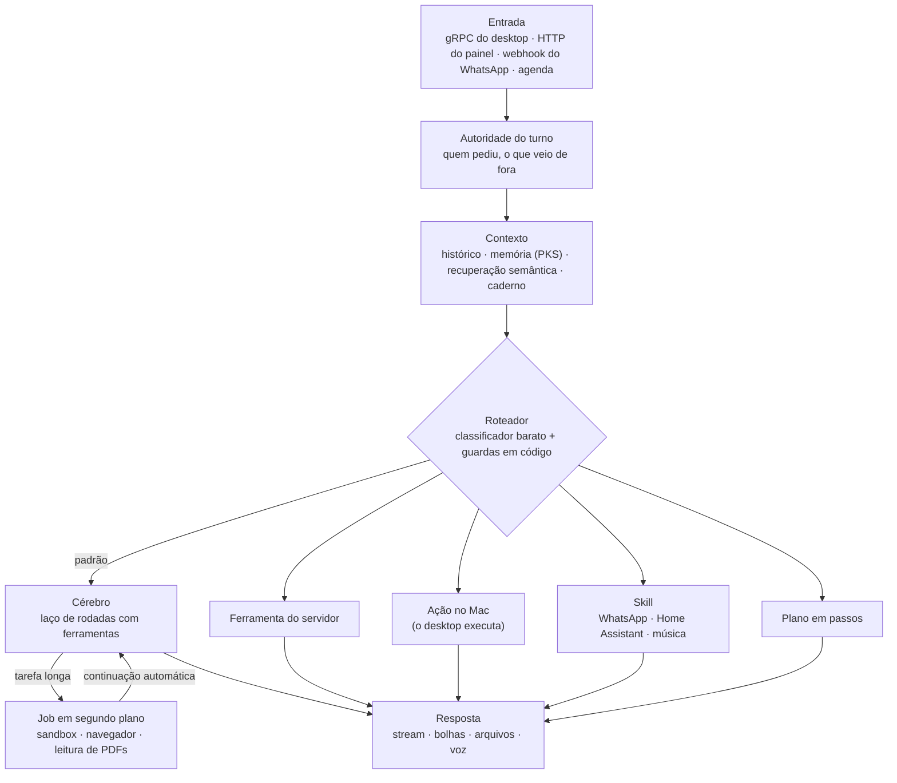

# neo-core

O cérebro do Neo: recebe cada pedido (desktop, painel, WhatsApp, agenda), decide o trilho, roda o laço de LLM com ferramentas e devolve a resposta em streaming. Também guarda a memória, executa os jobs e expõe a API HTTP e o gRPC.

Visão completa do fluxo: [`docs/mapa-tecnico-neo-core.md`](docs/mapa-tecnico-neo-core.md).

## Como um pedido anda



## Onde fica cada coisa

| Pasta | O que tem |
|---|---|
| `api/` | FastAPI: rotas HTTP (31 módulos), autenticação, WebSockets de aparelhos |
| `grpc_server.py` | Canal bidirecional com o app do Mac (`ExecuteTask`), incluindo as ações executadas lá |
| `modules/desktop/ai_service.py` | O turno inteiro: autoridade, contexto, roteamento, despacho, guardas sobre a resposta |
| `core/router/` | Classificador de intenção e as guardas determinísticas que o cercam |
| `core/cognitive/`, `core/pipeline/` | O laço de rodadas do cérebro e o orquestrador de etapas e handoffs |
| `core/authority/`, `core/release/` | Quem pode pedir o quê: turno contaminado, liberação de dado pessoal, risco das ações |
| `core/pks/`, `core/memory/`, `core/working_memory/` | Memória: grafo de conhecimento pessoal, recuperação híbrida de conversas, caderno de trabalho |
| `core/jobs/`, `core/scheduler/` | Tarefas em segundo plano, agenda (cron) e a continuação quando o job termina |
| `core/workbench/` | Sandbox Docker sem acesso à rede local, onde o Neo roda comandos e scripts |
| `core/browser_local/` | Driver do navegador do usuário: snapshot da página, ações, caderno, cofre de senhas, juiz de formulários |
| `core/documents/` | Leitura delegada de PDFs longos, com citação conferida contra o texto |
| `core/claude_code/` | Delegação de tarefas de código ao Claude Code no Mac |
| `core/llm/` | Provedores, catálogo de modelos por tarefa e teto adaptativo de raciocínio |
| `skills/` | Skills em `SKILL.md` (docx, finanças, OCR de vídeo, análise de CSV…) |
| `config/neo.toml` | **Todo número de comportamento** (tetos, prazos, limiares) mora aqui, não espalhado no código |
| `alembic/` | Migrations do PostgreSQL |
| `docs/` | Um plano por frente, com o problema, o que foi medido e o que falta |

## Rodar

O core roda em Docker, a partir da raiz do repositório:

```bash
docker compose up -d neo-postgres neo-core   # API em :8000, gRPC em :50051
make migrate                                 # aplica as migrations pendentes
```

Em desenvolvimento, o `entrypoint-dev.sh` sobe o `uvicorn` com `--reload`.

## Testar

```bash
uv run pytest                                  # 4.701 testes, ~50 s
uv run python scripts/eval_router.py --ab       # golden set do roteador contra o modelo configurado (usa a chave do .env)
```

Os testes não chamam modelo nenhum: provedores de LLM e sandbox são substituídos por dublês. As medições com modelo de verdade ficam nos scripts `eval_*` e estão descritas em [`../evals/README.md`](../evals/README.md).
