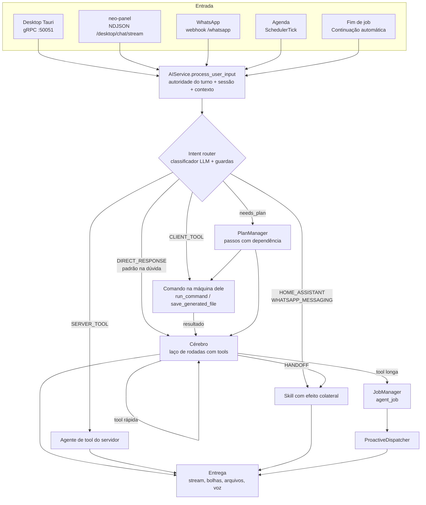
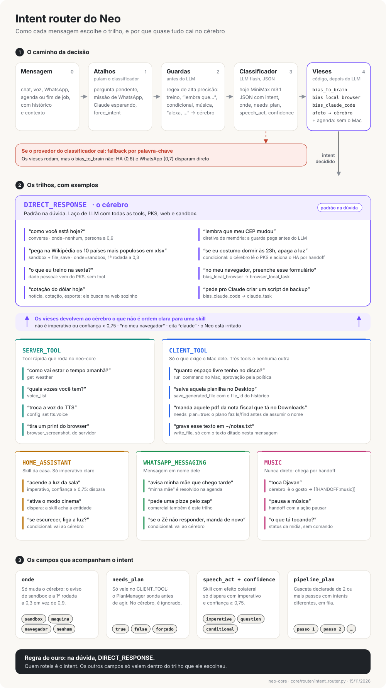
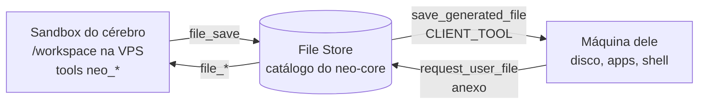
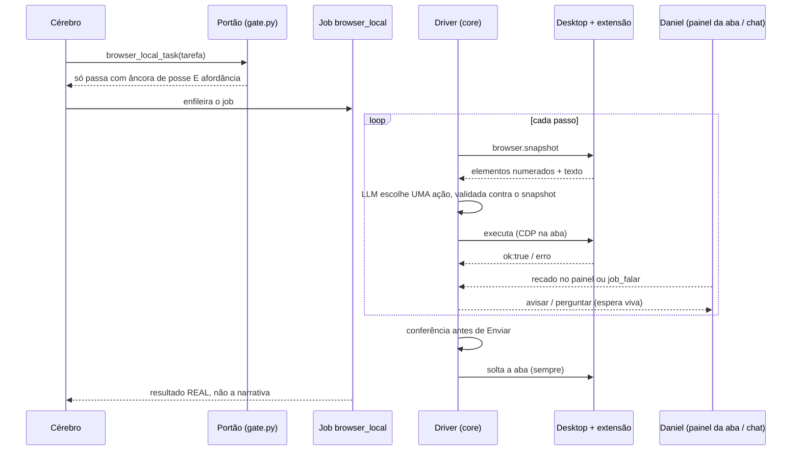

# Mapa técnico do Neo Core

Estado em 14/11/2026. Este mapa descreve como um pedido entra no Neo, quem decide o que fazer com ele e por onde a resposta sai. Para o detalhe de cada parte, siga os links para o código e para os planos em `docs/`.

**Em uma frase:** todo pedido passa por um classificador barato que escolhe o trilho. Quase tudo cai no cérebro, um laço de LLM com ferramentas. O que é perigoso, caro ou fácil de errar é decidido por código, não pelo modelo.

---

## 1. O caminho de um pedido



Passo a passo, em [modules/desktop/ai_service.py](../modules/desktop/ai_service.py) (`process_user_input`):

1. **Autoridade do turno.** Antes de tudo, o código registra quem pediu e o que veio de fora (texto colado, URL que você escreveu). Ver §10.
2. **Entrada por voz.** O backstop determinístico corrige nomes que o STT erra, antes do classificador.
3. **Sessão.** O turno pega ou cria a sessão. No chat ela só muda por ação sua; o modo live expira pelo relógio.
4. **Contexto, em paralelo:** histórico, recuperação semântica, PKS e caderno. Depois vem um segundo passe com o embedding pronto. Ver §3.
5. **Contexto do sistema:** modo live, voz, imagens, identidade, manifesto dos anexos, artefatos, ledger de arquivos e a tarefa viva do navegador.
6. **Classificação.** O roteador decide o trilho. Ver §4.
7. **Despacho.** O `PipelineOrchestrator` roda o passo e os handoffs que ele gerar.
8. **Saída.** Todo trilho passa pelo ponto do afeto e pelo epílogo da birra antes de sair. O diário da sessão grava cada etapa.

---

## 2. Canais de entrada

| Canal | Transporte | Entra em | Particularidade |
|---|---|---|---|
| Desktop (Tauri) | gRPC bidi `ExecuteTask`, porta 50051 | [grpc_server.py](../grpc_server.py) → `AIService` | Único canal que executa tool no Mac (`tool_request`) |
| neo-panel | `POST /api/v1/desktop/chat/stream` (NDJSON) | [api/routes/desktop.py](../api/routes/desktop.py) | Ignora `tool_request`: o navegador não tem SO |
| WhatsApp | serviço Node `neo-whatsapp` → webhook | [api/routes/whatsapp.py](../api/routes/whatsapp.py) | Remetente vira principal `externo` |
| Voz / modo live | STT :5005 e TTS :5006 no PC gamer; desktop fala direto na LAN | `metadata["mode"]="live"` | Resposta final sai falada; sessão expira por inatividade |
| Agenda | `SchedulerTick` → `agent_job` `scheduled_*` | [core/scheduler/](../core/scheduler/) | Principal `agenda`, sem ninguém na tela: CLIENT_TOOL não vale |
| Fim de job | mensagem sintética `[Continuação automática…` | volta ao laço como turno novo | PKS não aprende com ela |
| Aparelhos | `/ws/devices/*` (online, notificações, controle) | [api/routes/devices.py](../api/routes/devices.py) | A extensão do navegador é um aparelho pareado |
| Eventos de mídia | `POST /api/v1/eventos/midia` | [core/events/router.py](../core/events/router.py) | Não acorda o cérebro: a resposta do POST já é o comando |

**Atenção:** `127.0.0.1:8000` e `:50051` no Mac são um túnel para a VPS. Testar "local" é testar em produção.

---

## 3. Sessão e montagem do contexto

O [SessionManager](../core/session/session_manager.py) cria, recupera e fecha sessões e conta tokens. A rotação por tópico ainda existe, mas não vale nos canais de chat (`neo-desktop`, `neo-panel`): ali a conversa só muda por ação sua.

O prompt do cérebro é montado pelo [PromptContextSelector](../core/agent/context_selector.py), que pontua candidatos e enche um orçamento de tokens:

- **Blocos do PKS**, os mesmos em todo turno: `neo-personality`, `neo-response-rules` e `neo-communication-preferences` (estes dois de alta prioridade), `daniel-profile`, `active-projects`, `neo-goals`, `neo-operating-procedures`, `neo-world-state` e `neo-training-examples`.
- **Recuperação de contexto**: trechos de conversas antigas por busca híbrida, com o rótulo `[memória · outra conversa · dd/mm]`.
- **Índice do caderno**: uma linha por nota ativa, nunca o corpo.
- **Estado emocional**, só quando o límbico sai do repouso.
- **Histórico** com o `tool_trace` dos turnos anteriores, para um "cadê os arquivos?" não refazer o trabalho do zero.

### Orçamento de contexto

O orçamento é **fixo por camada**, em tokens ([shared/config.py](../shared/config.py), `context_budget_*`). Ele não é calculado a partir da janela do modelo.

| Camada | Teto | No limite |
|---|---|---|
| Blocos fixos do PKS (`pinned`) | sem teto | Entram sempre |
| `NEO_CORE_CTX` | 600 | Sai o candidato de nota mais baixa da camada |
| `USER_PREFS` | 500 | Idem |
| `USER_PKS` | 900; até 1.600 com o ranking v2 | Idem |
| `RETRIEVED` (conversas antigas) | 1.200, e só com nota ≥ 0,25 | Idem |
| `WORKING_MEM` (índice do caderno) | 700 | Corta as últimas notas do índice; o índice nunca sai inteiro |
| Histórico da sessão | 40 mensagens e 24.000 tokens | A mensagem grande vira o marcador "OMITIDA desta janela por tamanho" (até 3). Depois, um 2º passe traz de volta até 4 mensagens parecidas com a pergunta |

A única parte elástica é o PKS com ranking v2: um grupo forte estende o bloco de 900 até 1.600 (`pks_rank_budget_max`). A flag `pks_ranker_v2_enabled` vem desligada por padrão.

**Dentro do turno não há corte dinâmico.** Cada rodada do cérebro reenvia tudo, e os resultados das tools se acumulam por até 32 rodadas. O tamanho fica contido pelos tetos de cada tool:
- `web_fetch`: 40 links e 4.000 caracteres de tabela;
- leitura de arquivo do sandbox: teto em bytes, com aviso `truncated`;
- resultado do desktop: cortado em 1 MB;
- aviso de repetição: 800 caracteres.

Nada compara o prompt com a janela do modelo.

Regra que veio da sessão 7330e40c: **todo corte leva marcador**. Corte mudo vira confabulação, porque o modelo não sabe que há um buraco e preenche com o que alcança.

Lição: uma regra enterrada em 27 mil caracteres de sistema perde para skill ativa e para resultado de tool. A mesma frase logo depois da mensagem do usuário deu 8 de 8 (sessão 455646dd). Posição pesa mais que redação.

---

## 4. Intent router

Fica em [core/router/intent_router.py](../core/router/intent_router.py). Roda antes de todo turno, num modelo flash barato: hoje `minimax-m3.1-flash@nebius`, com teto de raciocínio de 300 tokens. Devolve um `RoutingDecision` ([shared/types.py](../shared/types.py)).



*Para mudar o mapa: edite os textos em `scripts/gerar_mapa_intent_router.py` e rode `python3 scripts/gerar_mapa_intent_router.py`.*

### Os trilhos

| Intent | Quando | Quem executa |
|---|---|---|
| `DIRECT_RESPONSE` (= `cognitive`) | Conversa, conhecimento, dado pessoal e tudo que roda no sandbox. **Padrão na dúvida.** | Cérebro |
| `SERVER_TOOL` | Dado em tempo real (clima), configuração do Neo, print do browser do servidor | Agente de tool no neo-core |
| `CLIENT_TOOL` | Só o que exige a máquina dele: `run_command`, `write_file`, `save_generated_file` | Desktop |
| `HOME_ASSISTANT` | Casa inteligente, num imperativo claro | Skill HA |
| `WHATSAPP_MESSAGING` | Mandar mensagem em nome dele | Pipeline do WhatsApp |
| `MUSIC` | Nunca direto: chega por handoff do cérebro, para as regras de gosto do PKS valerem | Skill de música |

### Os campos que mais pesam

- **`onde`** (`sandbox`, `maquina`, `navegador`, `nenhum`): a decisão que mais erra. Quem decide é a **origem** do conteúdo, nunca o destino. Baixar um PDF da internet e salvar no Desktop é `sandbox` + ponte, não `maquina`.
- **`speech_act`** e **`confidence`**: skill com efeito colateral só dispara com imperativo e confiança ≥ 0,75.
- **`needs_plan`**: leva ao PlanManager (§6), mas **só no trilho CLIENT_TOOL**. Ver "Como os campos se combinam", abaixo.
- **`tipo_tarefa`** (`simples`, `multi_etapas`, `analitica`, `criacao`): hoje só alimenta o Registro de Contexto, que está em sombra.
- **`pipeline_plan`**: uma cascata declarada de 2 ou mais passos.
- **`skill_name`** / **`skill_hint`**, `needs_memory` e `knowledge_keywords`.

### Camadas em volta do LLM, na ordem

**Atalhos, antes de chamar o roteador.** O `ai_service` confere, nesta ordem, quatro situações em que o classificador nem é chamado (log `[INTENT-OVERRIDE]`):
1. o Neo fez uma pergunta de esclarecimento no turno anterior: esta mensagem é a resposta e vai ao cérebro;
2. há uma missão de WhatsApp ativa e a mensagem parece continuação dela: vai ao WhatsApp;
3. há uma tarefa do Claude Code esperando resposta nesta sessão: vai ao cérebro, porque só ele tem o `claude_reply`. Sem isso, "pode rodar" virou `run_command` (job decc8224);
4. `force_intent` no metadata, usado em testes: o trilho pedido.

Fora desses casos, o roteador roda:

1. **Guardas determinísticas antes do LLM.** Pegam treino do Neo, diretiva de memória ("lembra que…"), pergunta sobre aparelhos conhecidos, pergunta referencial ("de onde veio esse 22?"), ação condicional, música, status de mídia e nome de outro assistente ("alexa, …"). Todas caem no cérebro. Regra de ouro do arquivo: não criar padrão por frase para consertar rota errada.
2. **Classificador LLM**, com saída JSON nativa e reparo de rede. O `_parse_classification` monta o `RoutingDecision` e termina em `_bias_to_brain`.
3. **Heurísticas de memória e rejeições:** eco do próprio prompt, destinatário de WhatsApp sem lastro na conversa, classificador redigindo arquivo e atalho de recall.
4. **Vieses finais, nesta ordem:** `_bias_local_browser` → `_bias_claude_code` → `_apply_affect_bias`.
5. **Correção depois do roteador:** num turno da agenda, sem ninguém na tela (`unattended`), CLIENT_TOOL vira DIRECT_RESPONSE, porque não há Mac para responder.

A tarefa viva no navegador não é atalho do `ai_service`. O `ai_service` só põe o bloco dela no contexto, e quem o lê é o `_bias_local_browser`.

**Caminho de reserva:** se o provedor do classificador cai, entra o `_fallback_classify` por palavra-chave. Depois dele rodam as heurísticas de memória e os três vieses do passo 4. As rejeições do passo 3 e o `_bias_to_brain` não rodam.

### Os vieses, um por um

**Os vieses são código, sem chamada de LLM.** Cada um é uma regra fixa aplicada a dois tipos de entrada: o texto da sua mensagem (regex, o portão do navegador) ou campos que o classificador já preencheu (`speech_act`, `confidence`, `tool_name`). Custam zero token e zero latência. A regra é determinística, mas parte da entrada é um palpite do LLM: se o classificador marcar "acende a luz?" como `imperative` com 0,9, o `_bias_to_brain` deixa passar.

Os quatro fazem a mesma coisa: **tiram a decisão de um trilho estreito e devolvem ao cérebro**. Zeram `skill_name`, `tool_name`, `tool_arguments` e `raw_command`, ligam `needs_memory` e escrevem o motivo em `explanation`, que aparece no diário. Nenhum leva a um trilho mais estreito. O motivo é sempre o mesmo: o cérebro tem o PKS, o modelo forte e todas as tools, e ainda pode acionar a skill depois por handoff.

| Viés | Dispara quando | Leva para | Por que existe |
|---|---|---|---|
| `_bias_to_brain` | Intent `HOME_ASSISTANT` ou `WHATSAPP_MESSAGING` que **não** seja imperativo com confiança ≥ 0,75 | `DIRECT_RESPONSE` | A skill com efeito colateral não lê o PKS. "Se eu costumo apagar a luz às 23h…" não é ordem. Troca o conjunto aberto ("pegar o que devia ir ao cérebro") por um fechado ("só passa imperativo claro") |
| `_bias_local_browser` | `browser_local_enabled` ligado **e** (o portão do navegador casa com a mensagem **ou** há tarefa viva no navegador e o classificador quis abrir outro) | `COGNITIVE` | `browser_local_task` e `job_falar` só existem no cérebro. Sem o viés, o pedido caía no Chromium do servidor: em 28/08/2026 o job terminou em `about:blank` |
| `_bias_claude_code` | A chave do Claude Code está ligada e a mensagem cita "claude" | `COGNITIVE` | `claude_task` só existe no cérebro. "Roda o Claude no meu Mac" viraria um `claude -p` cru por `run_command`, sem orquestração |
| `_apply_affect_bias` | O límbico pede (`force_brain`) e o intent é HA ou WhatsApp | `DIRECT_RESPONSE` | A skill não conhece o humor do Neo; o cérebro decide se atende, recusa ou responde atravessado |

Detalhes que não aparecem na tabela:
- **`_bias_to_brain`** só olha HA e WhatsApp. SERVER_TOOL e CLIENT_TOOL ficam intocados, porque para eles uma pergunta é o gatilho normal. Desliga com `router_bias_to_brain_enabled`; o limiar é `router_skill_confidence_threshold`.
- **`_bias_local_browser`** também liga `navegador_do_usuario` quando o pedido é imperativo e não há tarefa viva. Com isso o cérebro recebe o aviso de abrir o navegador nesta resposta, mesmo quando o intent já era o cérebro. Uma pergunta ("por que meu navegador travou?") não liga o sinal. O portão foi medido no corpus real: 15 marcações em cerca de 1.700 mensagens, zero falso positivo (`scripts/eval_browser_gate.py`).
- **`_bias_claude_code`** usa uma âncora larga de propósito. Mandar ao cérebro uma frase que só cita o Claude não custa nada, porque o cérebro é o trilho geral.
- O de navegador, o do Claude e o de afeto valem também no caminho de reserva. Um provedor caído é justamente quando a palavra-chave erra.

**Achado (15/11/2026):** no caminho de reserva, o fallback devolve HA com confiança 0,6 e WhatsApp com 0,7, ambos abaixo do limiar de 0,75. Se o `_bias_to_brain` rodasse ali, os dois iriam ao cérebro; como não roda, a skill dispara direto. O fallback de WhatsApp casa com palavras comuns como "manda", "mensagem" e "texto".

### Como os campos se combinam

**Quem roteia é o `intent`.** Os outros campos só valem dentro do trilho que ele escolheu, e nenhum código confere um campo contra o outro.

| Campo | Quem lê | Efeito |
|---|---|---|
| `intent` | `ai_service` (despacho) | Escolhe o handler |
| `onde` | Cérebro | `sandbox` com `DIRECT_RESPONSE` injeta o aviso "Onde esta tarefa roda": usar `web_search`, `neo_bash` e `file_save`, não procurar no computador dele nem pedir o link antes de buscar. Qualquer valor de tarefa (`sandbox`, `maquina`, `navegador`) põe a 1ª rodada a 0,3 em vez de 0,9. `nenhum` ou vazio mantêm a persona a 0,9 |
| `needs_plan` | Só o `_handle_client_tool` | Gera o plano e despacha o passo 1 ao Mac |
| `pipeline_plan` | `_run_pipeline` | Cascata de 2 ou mais passos com intents diferentes |
| `tipo_tarefa` | Registro de Contexto (em sombra) | Valor diferente de `simples` vira o registro OFICINA; hoje só loga |
| `speech_act` + `confidence` | `_bias_to_brain` | Decidem se HA ou WhatsApp dispara |
| `navegador_do_usuario` | Cérebro | Aviso para abrir o navegador nesta resposta |

**Dá para ter `onde=sandbox` com `needs_plan=true`?** O JSON aceita, mas não muda nada. O prompt do classificador manda deixar `needs_plan` falso fora do CLIENT_TOOL, e o código só lê o campo nesse handler. Com `DIRECT_RESPONSE`, o cérebro planeja sozinho dentro das rodadas: cada rodada é um passo, até 32. O PlanManager serve para o Mac, onde cada passo é uma ida e volta ao desktop e o plano precisa sondar antes de agir (`ls` ou `find` antes de assumir um nome de arquivo).

**Combinações e para onde vão:**

| intent | onde | needs_plan | O que acontece |
|---|---|---|---|
| DIRECT_RESPONSE | sandbox | false | Cérebro com aviso de sandbox, 1ª rodada a 0,3. É o caso da planilha da Wikipédia |
| DIRECT_RESPONSE | sandbox | true | Igual à linha de cima; `needs_plan` ignorado |
| DIRECT_RESPONSE | nenhum | qualquer | Conversa: persona a 0,9, sem aviso |
| DIRECT_RESPONSE | navegador | qualquer | Cérebro a 0,3. Se o portão casar e for uma ordem, entra o aviso de abrir o navegador |
| CLIENT_TOOL | maquina | false | Comando direto ao Mac, com card de aprovação salvo o que a política de auto-aprovação libera |
| CLIENT_TOOL | maquina | true | O PlanManager gera o plano, despacha o passo 1 e segue em `process_tool_result`. Plano vazio, passo sem comando ou tool fora do catálogo → cérebro |
| CLIENT_TOOL | qualquer | forçado | Caminho ou URL do comando que não aparece na conversa: o argumento é descartado e o plano começa por uma sondagem |
| CLIENT_TOOL ou SERVER_TOOL com `browser_local_task` | qualquer | qualquer | Vira DIRECT_RESPONSE, com `needs_plan` zerado e `navegador_do_usuario` ligado |
| CLIENT_TOOL com tool fora do catálogo | qualquer | false | Vira DIRECT_RESPONSE: despachar travaria o turno |
| Cascata (`pipeline_plan`) | qualquer | por passo | Passo CLIENT_TOOL sem comando ganha `needs_plan=true` sozinho |

**Descompasso sem guarda:** `onde=sandbox` com `intent=CLIENT_TOOL` vai ao Mac, e o aviso de sandbox não entra, porque ele exige DIRECT_RESPONSE. `onde=maquina` com DIRECT_RESPONSE vai ao cérebro a 0,3, sem aviso nenhum. Se o `onde` virar trava um dia, a guarda entra aqui.

Para medir mudança no prompt: `scripts/eval_router.py` com o golden set em `tests/router/golden_intents.yaml`.

---

## 5. Cérebro (laço cognitivo)

Fica em `_run_cognitive_tool_loop`, no [ai_service.py](../modules/desktop/ai_service.py). O modelo de produção é `deepseek-v4.1-flash` pelo OpenRouter, com o provider `open-inference` ignorado.

**O laço:** a cada rodada, o modelo recebe o contexto e as tools, chama zero ou mais tools, os resultados voltam como mensagem, e o ciclo segue. Termina quando ele responde sem chamar tool, ou no teto.

| Regra | Valor | Onde |
|---|---|---|
| Teto de rodadas | 32 | `cognitive_max_tool_rounds` (shared/config.py) |
| Temperatura da 1ª rodada (persona) | 0,9 | `[cerebro] temperatura` |
| Temperatura depois da 1ª tool (código, argumentos) | 0,3 | `temperatura_com_ferramentas` |
| Rodadas seguidas só com repetição antes de cortar as tools | 3 | `repeticoes_seguidas_max` |
| Trecho do resultado anterior no aviso de repetição | 800 chars | `repeticao_trecho_max` |

**Rodada** é uma chamada ao LLM dentro do laço: o modelo lê tudo, responde ou pede tools, e os resultados abrem a rodada seguinte. **Temperatura** controla o quanto o modelo sorteia a próxima palavra. Perto de 0, ele escolhe quase sempre a mais provável; a 0,9, varia mais. A 1ª rodada sai a 0,9 para a persona soar natural. Depois que uma tool roda, ou quando o `onde` diz que é tarefa, as rodadas saem a 0,3, porque ali o modelo escreve código, comando e argumento, e variação vira erro. Antes dessa regra, as 52 rodadas da sessão 20cb02b6 saíram a 0,9.

**Guardas que viraram código** (cada uma nasceu de uma sessão real):

- **Fim das rodadas:** a última rodada vai sem tools **e** com `_AVISO_FIM_DAS_RODADAS`. Sem o aviso, o DeepSeek devolvia `"\n\n"` (sessão 3229310a).
- **Chamada repetida:** não roda de novo. O modelo recebe `NÃO RODOU — chamada REPETIDA`, com o começo e o fim dos argumentos e o resultado anterior.
- **Lote de chamadas:** contaminação que chega dentro do lote de uma mesma resposta só vale quando o lote fecha (`lote_de_chamadas`, em core/authority/turn.py).
- **Anti-mentira de skill:** se a resposta afirma "registrei" e nenhuma tool da skill rodou, o turno ganha uma rodada extra com a tool obrigatória.
- **Anti-HANDOFF-de-tool:** `[[HANDOFF:save_generated_file]]` escrito em vez de chamado vira a chamada de verdade.
- **Auto-continuação:** `[[HANDOFF:continuar]]` abre outro passe. Um verificador pega a resposta que promete trabalho sem o bloco.
- **`annotate_result`:** o código cola avisos no resultado da tool, como "este arquivo é de OUTRA conversa" e "URL tirada da memória falhou, busque".

### Tetos: o que impede o turno de estourar no meio

Há dois tipos de teto: o de **saída**, que limita quantos tokens uma chamada pode gerar, e o de **trabalho**, que limita rodadas, passos e segundos.

**Teto adaptativo de saída** ([core/llm/teto_adaptativo.py](../core/llm/teto_adaptativo.py)). Hoje só o passo do navegador local usa (`[navegador.decisao]`).

O problema: modelos que não deixam desligar o raciocínio, como o GLM-5.3-flash, gastam o `max_tokens` pensando, e o JSON sai cortado. No job 9c9b5bae, com teto fixo de 2.000, isso aconteceu em 6 de 30 passos, e esses passos foram 28% do custo do job. Os passos que fecharam raciocinaram entre 29 e 1.566 tokens, então nenhum número fixo serve: ou corta a cauda, ou fica largo demais.

A solução usa a mesma conta do timeout do TCP (RFC 6298), com média e desvio móveis por modelo:

```
teto      = reserva_resposta + orçamento
orçamento = média + desvios × desvio
```

| Parâmetro (`[teto_adaptativo]` e `[navegador.decisao]`) | Valor | Papel |
|---|---|---|
| `reserva_resposta` | 600 | Espaço do JSON (o maior medido teve 356 tokens) |
| `piso` / `maximo` | 2.000 / 6.000 | Ponto de partida e limites; 6.000 ≈ 30 s no pior passo |
| `peso_media` / `peso_desvio` | 0,125 / 0,25 | Quão rápido média e desvio reagem a uma medida nova |
| `desvios` | 4 | Folga acima da média |
| `fator_corte` | 1,5 | Num corte, o raciocínio medido entra ×1,5, porque o real era maior |
| `fator_escada` | 2 | O passo cortado repete a MESMA chamada com o teto ×2, até o máximo, antes de virar recusa |

Um corte acontece quando o raciocínio invade a reserva da resposta. O teto sobe sozinho depois de um passo pesado, desce nos leves e reaprende quando o modelo muda. O aprendido fica na memória do processo, então um reload volta ao piso e a escada cobre o recomeço. **Teto não é gasto:** o provedor cobra o que o modelo gera, e subir o teto só custa no passo que de fato raciocina mais.

**No cérebro, os tetos de saída são fixos, com retentativa:**
- `max_tokens` de 8.192 por rodada (`default_max_tokens`);
- resposta vazia repete com o dobro, até 16.384;
- argumento de tool cortado pelo limite ganha até 2 rodadas de retentativa. Depois, o Neo pede para escrever em partes;
- teto de 32 rodadas, corte das tools depois de 3 rodadas seguidas de repetição, e aviso de fim na última rodada.

**Tetos de tempo e de trabalho.** Contam por inatividade, não por relógio:
- **Turno no desktop:** morre com 90 s sem nenhuma mensagem. Enquanto espera o Mac responder, o teto é de 1 h. O gRPC manda keepalive a cada 15 s, só se houve progresso real nos últimos 240 s.
- **Sandbox:** o `neo_bash` só morre se a árvore de processos ficar parada pela janela de travamento (30 a 300 s, padrão 90). Passou de 120 s trabalhando, vira job.
- **Comando no Mac:** passou de 90 s, vira tarefa local, com teto de 2 h.
- **Idas e voltas entre cérebro e Mac num turno:** até 16 (`_MAX_ACTUATION_DEPTH`).
- **Navegador local:** cada mensagem sua devolve 15 passos ao orçamento da tarefa, com teto de 150.

**Handoffs:** o cérebro aciona uma skill escrevendo `[[HANDOFF:home_assistant]]<ordem>[[/HANDOFF]]`. O [handoff_parser](../core/pipeline/handoff_parser.py) extrai o bloco e o [orchestrator](../core/pipeline/orchestrator.py) enfileira o passo. É assim que música e HA passam pelas regras do PKS.

---

## 6. Planos, skills e pipeline

**PlanManager** ([core/planning/plan_manager.py](../core/planning/plan_manager.py)):
- guarda os planos em memória, por sessão, com passos ordenados e sub-planos;
- depois de cada `tool_result`, o plano avança e se refina (`advance_and_refine`);
- o plano guarda o **pedido literal** (`ExecutionPlan.pedido`), não só a paráfrase. Sem isso, o zip de 4,5 GB foi parar em `~/` com a árvore `Users/daniel/...` (sessão 7b61bc5e).

**Skills** (`neo-core/skills/<nome>/SKILL.md`, carregadas por [modules/skills_library](../modules/skills_library/)):
- hoje: `analise-csv`, `clientes`, `compras`, `criar-cadastro`, `diagnostico-voz`, `docx`, `financas`, `imitacao-vozes`, `ocr-video`, `playlists`, `postgres-neo`, `produtos`;
- **tool gating:** a skill `tool_backed` destrava as tools dela quando o cérebro faz `skill_read`;
- **autoload por palavra-chave:** a skill entra sozinha e força `tool_choice=required` na 1ª rodada.

**Cadastros** (`datasets:` no SKILL.md): viram tabela mais as tools `data_*`, sem código novo.

---

## 7. Ferramentas e jobs

### Três lugares físicos, sem filesystem compartilhado



O [FileLedger](../core/files/ledger.py) registra onde está cada cópia, em dois anéis: arquivos desta conversa e de outras. Nada cruza por caminho escrito à mão: um `/workspace/...` num `run_command` sempre falha.

### Famílias de tool

| Família | Exemplos | Onde roda |
|---|---|---|
| Leitura do cérebro | `search_pks`, `wm_read`, `conversation_recall`, `get_weather` | neo-core |
| Web | `web_search` (só o Google CSE está vivo), `web_fetch` | neo-core |
| Sandbox | `neo_bash`, `neo_read_file`, `file_save`, `file_olhar` | container workbench |
| Transcrição | `neo_transcrever`: o sandbox tira o áudio, o Whisper do Groq transcreve ([transcricao-groq.md](transcricao-groq.md)) | sandbox + Groq |
| Documentos | `deep_read`, `docx_*` | job / sandbox |
| Cliente | `run_command`, `write_file`, `save_generated_file`, `read_user_file`, `edit_user_file` | Mac, via `tool_request` |
| Jobs | `neo_bash_background`, `job_*`, `job_falar`, `browser_local_task`, `claude_task`, `claude_reply` | JobManager |
| Domínio | `fin_*`, `data_*`, `ha_*`, música, agenda | neo-core |

O caminho CLIENT_TOOL: o core manda o `tool_request`, o desktop executa e devolve, e `process_tool_result` reentra no cérebro (`_reenter_cognitive`). Um comando que passa de 90 s vira tarefa local (`comando_local`). Todo resultado é cortado em 1 MB.

### JobManager

O [JobManager](../core/jobs/manager.py) roda um tick no mesmo processo do neo-core. Ele reivindica linhas de `agent_job` com claim atômico e dispara um worker por job, limitado por semáforo.

- **Runners:** `browser` (Chromium headless do servidor), `browser_local`, `claude`, `claude_sessao`, `comando_local`, `deep_read`, `download_watch`, `research` e `scheduled_*`.
- **Restart-safe:** no boot, job preso em `running` vira `failed`, exceto os de `REATTACHABLE_JOB_KINDS`, que voltam para a fila.
- **`neo_bash` acima de 120 s** vira job sozinho. O parâmetro `then` diz o que fazer quando ele terminar.
- **Entrega:** o [ProactiveDispatcher](../core/jobs/dispatcher.py) redige com a persona, salva na sessão de origem e publica `chat_message` no broker, com fan-out por aparelho e replay offline. Um texto literal pula o redator.

---

## 8. Navegador local

O navegador local é o Edge dele, logado, dirigido pela extensão e pelo desktop. Quem decide é o core; o aparelho só executa.



**Peças** (em [core/browser_local/](../core/browser_local/)):

- **[gate.py](../core/browser_local/gate.py):** só age na tela dele se ele pediu. A regra exige uma âncora de posse ("meu", "aqui") **e** uma afordância ("navegador", "aba").
- **[surfaces.py](../core/browser_local/surfaces.py):** quem pode dirigir um navegador. O desktop é o provedor completo (visível e headless); a extensão é um aparelho pareado.
- **[driver.py](../core/browser_local/driver.py)**, o laço ver → decidir → agir, com quatro princípios:
  1. a verdade vem do aparelho;
  2. `ok:true` não quer dizer que a página reagiu: tela que não mudou carimba o passo como inútil;
  3. ação ou `ref` inventados são recusados antes de sair;
  4. a aba é solta no fim, sempre.

  A percepção é texto por padrão. A imagem entra pela ação `look`, e quem responde é um modelo de visão, que não decide o passo.
- **[conversa.py](../core/browser_local/conversa.py):** caixa de entrada em memória por job vivo, com `avisar`, `perguntar`, o painel da aba e `job_falar`. A pergunta com botões só nasce pelo canal privilegiado, porque a página consegue imitar `postMessage`.
- **[respondedor.py](../core/browser_local/respondedor.py):** a ação `consultar` responde formulário pela memória, pergunta por pergunta, com aterramento. No driver, `_check_revisao` para antes de Enviar quando algum campo veio da memória.
- **[juiz.py](../core/browser_local/juiz.py):** julga grade de avaliação (`julgar`, `marcar_grade`) com modelo próprio. Linha sobre o Daniel volta `PESSOAL`.
- **[cofre.py](../core/browser_local/cofre.py):** a senha nova é gerada pelo código como `«senha:nova»` e vai para o cofre. Nunca passa pelo prompt, pelo caderno ou pela leitura da página.
- **Escopo de domínio** (`_allowed_hosts`): a mensagem dele amplia o escopo; a página nunca amplia.

Constantes em `[navegador.*]` do neo.toml. O diário do job fica em `/app/logs/browser_local/<job>/trace.md`. A extensão precisa de reload manual em `edge://extensions`.

---

## 9. Memória

| Camada | O que guarda | Como entra no turno | Código |
|---|---|---|---|
| PKS | Entidades, campos e relações sobre ele e o Neo (ontologia) | Blocos fixos + busca ranqueada por orçamento de tokens | [core/pks/](../core/pks/) |
| Recuperação passiva | Trechos de conversas antigas | Todo turno, orçamento apertado, por similaridade | `SessionManager.recover_context` |
| `conversation_recall` | Arquivo de conversas | Só a pedido: FTS → trigram → vetor, em cascata | [core/memory/conversation_recall.py](../core/memory/conversation_recall.py) |
| Caderno (working memory) | Notas da tarefa atual e `artefatos-recentes` | Índice em todo turno; corpo só com `wm_read` | [core/working_memory/](../core/working_memory/) |
| Ledger de arquivos | Onde está cada cópia, versões | Bloco "ARQUIVOS DESTA CONVERSA" + aviso no resultado | [core/files/ledger.py](../core/files/ledger.py) |
| Afeto (límbico v2) | 5 emoções e postura | Bloco condicional; teto de tom | `NEO_AFFECT_ENABLED` |

**Como o PKS aprende** ([writer.py](../core/pks/writer.py)): o LLM propõe, o backend valida contra a ontologia e o repositório executa. São dois momentos: `learn_before_response` e `learn`, depois da resposta. O aprendizado automático é pulado em mensagem sintética do Neo e recusado em turno contaminado (texto colado, página lida). `pks_remember`, quando ele manda guardar, sempre vale.

O **ranking** ([ranking.py](../core/pks/ranking.py)) roda em 5 estágios (consulta, candidatos, nota, agrupamento, empacotamento) e é puro: o mesmo código serve ao turno, à `search_pks` e ao benchmark.

Defeitos conhecidos e ainda abertos:
- o extrator ainda transforma "sou X" em nome;
- a recuperação semântica traz recusas antigas como precedente (score 0,99).

---

## 10. Autoridade e segurança

Fica em [core/authority/](../core/authority/). O princípio: **o código escreve, o modelo não**. Quem decide lê um objeto que nenhum LLM consegue alterar.

O `TurnAuthority` ([turn.py](../core/authority/turn.py)) guarda três coisas:
1. **Principal**: quem originou o turno (`admin` = ele, `externo` = remetente de WhatsApp ou e-mail, `agenda`).
2. **Contaminação**: se conteúdo de terceiro entrou no contexto. Contaminado não é proibido; a saída passa pelo portão. Texto colado de 240 caracteres ou mais (`pasted_chars`) já conta.
3. **Procedência de URL**: as URLs vistas em resultado de tool. É isso que transforma a regra do prompt "só use URL que você viu" numa verificação.

O **portão** ([gate.py](../core/authority/gate.py)) pergunta "quem pediu isto?" e consulta a tabela de risco. Ele é chamado pelos dois executores de tool, o global e o cognitivo. Modo `NEO_RELEASE_GATE_MODE`: `shadow` (padrão, só loga `[authority][sombra]`) ou `enforce`.

A **liberação** ([core/release/service.py](../core/release/service.py)) é feita com um card no aparelho:
- `create` é chamado por quem precisa do dado;
- `decide`, só pelas rotas de aprovação, com a identidade do token;
- `consume` é de uso único, com hash do conteúdo aprovado.

Nenhuma tool aprova.

**Credenciais:** ficam num cofre tipado, cifrado com Fernet (`NEO_CRED_KEY`). O service gateway faz HTTP sem o LLM ver a credencial.

**Rotas HTTP:** o `Principal` está em sombra (`NEO_API_AUTH_MODE=shadow`). Falta o segredo e virar enforce.

Achado aberto: o `web_fetch` bloqueado vira `curl` no `neo_bash`, e esse caminho está só em sombra. Uma nota no prompt não impede injeção.

---

## 11. Entrega

O `AIService` emite um fluxo de `AIServiceResponse`. O gRPC converte em `CoreMessage` e o painel em NDJSON. Os eventos:

| Evento | O que é | Quem mostra |
|---|---|---|
| `thinking` | Progresso; `[[CYCLE]]` marca um passe de auto-continuação | Desktop, painel |
| `plan_update` | Estado dos passos do plano | Desktop, painel |
| `command_request` | Card de aprovação de comando | Desktop executa; painel só recusa |
| `tool_request` | Tool que o Mac executa | Só o desktop |
| `assistant_message` | Bolha intermediária persistida (passes, entregas parciais) | Todos |
| `complete` | Resposta final, com `files` (anexos clicáveis do `file_save`) | Todos |

Outras saídas:
- **Arquivo no disco dele:** `save_generated_file`, com caminho literal e criação de pasta.
- **Imagem no chat:** o marcador `[[IMAGE:caminho]]` vira data URL no cliente; os bytes não passam pelo prompt.
- **Arquivo que já está no Mac:** o marcador `[[FILE:caminho]]` vira um cartão com nome, tamanho e "Mostrar no Finder" (`stat_local_file` + `reveal_in_folder` no Rust; não abre o arquivo, porque o caminho vem do modelo). Serve para o que foi baixado na máquina dele, em vez de `file_save`. O corpo do marcador vai até o `]]`, porque o yt-dlp põe `[id]` no nome. A instrução (`_LOCAL_FILE_INSTRUCTION`) segue o mesmo gate do `[[IMAGE:…]]`. Se o cérebro tentar `request_user_file(stage=false)` de vídeo/áudio só para entregar, a 1ª chamada não roda e volta `_AVISO_MIDIA_JA_ESTA_NO_MAC`; a 2ª igual passa (e-mail, WhatsApp), e `stage=true` (processar) nunca é barrado.
- **Vídeo do YouTube por nome:** `neo_video_candidatos` escolhe antes de baixar (dados → quadros → perguntar), e download às cegas fica travado. Ver `docs/video-candidatos.md`.
- **Site que barra o sandbox:** quando o `neo_bash` recebe bot-check/login do yt-dlp ("confirm you're not a bot", "--cookies-from-browser"), o resultado ganha `_AVISO_ORIGEM_BLOQUEADA`. O aviso manda rodar o mesmo yt-dlp por `run_command` no Mac, que tem IP residencial, e entregar com `[[FILE:…]]`. Sem `run_command` no turno, o aviso só manda contar ao Daniel. Caso de origem: session-3ed86282.
- **Voz:** no modo live, a resposta final vai ao TTS. `[[VOICE:nome]]` divide em segmentos com outra voz.
- **Depois do turno:** resultado de job e disparo de agenda chegam pelo ProactiveDispatcher, como bolha nova, notificação no aparelho e replay quando ele voltar.
- **WhatsApp:** saída pelo `neo-whatsapp`; o `/notify` passa pelo nginx :8091 com `X-Notify-Token`.

---

## 12. Configuração, observabilidade e onde mexer

**Configuração**
- `config/neo.toml`: números de comportamento, nas seções `[cerebro]`, `[roteador]`, `[navegador.*]`, `[trabalho]`, `[web]`, `[faxina]`, `[comando_no_computador]`, `[grpc]`, `[openrouter]`, `[teto_adaptativo]` e `[transcricao]`. Regra da casa: número novo vai para cá.
- `.env` **da raiz** do monorepo, que é o único que o container lê. Mudou o `.env`: `docker compose up -d --no-deps neo-core`.
- Catálogo de LLM, slots, chaves e configuração de intent: Postgres, pelo neo-panel.
- Transcrição (chave do Groq, modelo, "só a cota gratuita"): Postgres, pelo neo-panel, em Configurações → Transcrição.

**Onde olhar quando algo dá errado**

| Pergunta | Fonte |
|---|---|
| O que aconteceu num turno | Diário da sessão `.md` no container: etapas 1–8. Desde 20/11/2026, cada mensagem do prompt vai inteira só na 1ª vez (marca `#sha`); depois vira `= #sha` ou diff (`observability/session_log_payload.py`) |
| Payload exato de uma rodada (A/B) | `docker exec -w /app neo-core python scripts/payload_do_log.py /app/logs/session-<id>.md --listar`, depois `--interacao N --rodada K`. Lê também os diários antigos |
| Corpo inteiro do classificador | `docker logs neo-core \| grep 'Request options'` |
| Passo a passo de um job do navegador | `/app/logs/browser_local/<job>/trace.md` |
| Tokens e finish por rodada | `GET /api/v1/generation?id=` do OpenRouter, pelos `x-generation-id` do app.log |
| Folga da chave | `GET https://openrouter.ai/api/v1/key` |
| Desktop | Log do Tauri (5 MB × 5) |
| Desktop ou painel sem conexão com o core | Túnel WireGuard e socat no Mac: `docs/wireguard-mac-vps.md` |
| Quem entrou na VPS; SSH recusando senha | Vigia (avisos no Discord) e SSH só com chave: `docs/vps-vigia-ssh.md` |

**Testes:** cerca de 4.400 no Python e 125 no Rust. Rode com `neo-core/.venv/bin/pytest`. Evals em `scripts/eval_*.py`: roteador, portão do navegador, recall, tom e GAIA.

**Mapa de pastas do neo-core**

| Pasta | O que mora lá |
|---|---|
| `api/` | Rotas FastAPI, auth, schemas |
| `grpc_server.py` | Transporte do desktop |
| `modules/desktop/ai_service.py` | O orquestrador do turno (14 mil linhas): roteamento, cérebro, CLIENT_TOOL, entrega |
| `core/router/` | Classificador e guardas |
| `core/pipeline/`, `core/planning/` | Cascata, handoff e planos |
| `core/agent/` | Seleção de contexto do prompt |
| `core/pks/`, `core/memory/`, `core/working_memory/`, `core/session/` | Memória |
| `core/authority/`, `core/release/`, `core/credentials/`, `core/gateway/` | Segurança |
| `core/jobs/`, `core/scheduler/`, `core/events/`, `core/notifications/` | Trabalho em segundo plano e entrega |
| `core/browser_local/` | Navegador local |
| `core/files/`, `core/workbench/`, `core/documents/` | Arquivos, sandbox, leitura delegada |
| `skills/` | Skills em SKILL.md |
| `config/neo.toml` | Constantes de comportamento |

**Pontos frágeis do sistema**
- **Salvar é deploy.** Mutagen mais `--reload`: um `.py` salvo no Mac vai para produção na hora. Dependência nova no `pyproject.toml` derruba o processo no reload. `scripts/`, `tests/` e `docs/` ficam fora do reload.
- **Muita coisa sem commit.** Vários consertos de produção estão só no disco.
- **Portões em sombra.** Autoridade, auth das rotas e ranking v2 do PKS medem, mas não barram.
- **Teste de ponta a ponta pendente** em umas 17 features: formulário, docx, cofre, Claude Code, URL de memória e outras.
- **O prompt não é medido dentro do turno.** Os orçamentos de contexto são fixos e valem na montagem. Nas rodadas, o prompt cresce com os resultados das tools, e nada o compara com a janela do modelo.
- **Fallback do roteador sem `_bias_to_brain`.** Quando o classificador cai, HA (0,6) e WhatsApp (0,7) disparam direto. Ver §4.
- **O defeito mais caro é dado errado dito com confiança**, não travar. É por isso que o eval do GAIA separa "errou com confiança" de "não sei".
