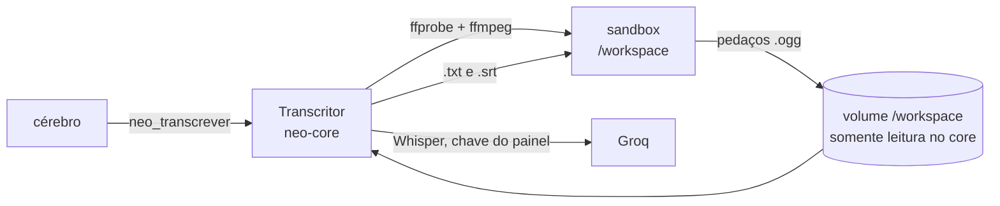

# Transcrição de vídeo e áudio pelo Groq

A tool `neo_transcrever` transcreve a fala de um vídeo ou áudio que está no sandbox (`/workspace`) ou no catálogo (`file_id`). O sandbox só tira o áudio. Quem transcreve é o Whisper do Groq, então a CPU da VPS quase não trabalha. O resultado volta como `<nome>.transcricao.txt` e `<nome>.transcricao.srt`, ao lado do arquivo.

Nasceu em 15/11/2026 para uso pessoal, presa à cota gratuita do Groq. Antes dela foram descartados:

- **Vosk no sandbox:** leve, mas erra 32% das palavras em fala lida e 69% em fala espontânea, segundo os números do próprio Vosk.
- **Whisper ou Parakeet no sandbox:** não cabem no sandbox (1 GB, 1,5 vCPU).
- **A cascata Parakeet do neo-voice:** depende do PC gamer ligado, e o sandbox não alcança a LAN.

## O caminho

1. **Sondar:** o `ffprobe` diz se há faixa de áudio e quanto dura. Sem áudio, a tool recusa.
2. **Conferir a cota, se "só a cota gratuita" estiver ligado.** A tool vê se o áudio inteiro cabe agora, ou com no máximo `espera_max_s` de espera. Se não cabe, recusa sem ter mandado nada e diz quando dá para continuar (`volta_em_s`).
3. **Medir o som:** um `silencedetect` (−40 dB, 1 s) no sandbox, que decodifica só o áudio. Com menos de 5% do áudio com som, a tool recusa antes de gastar cota e aponta a skill ocr-video: é gravação de tela sem fala, e o Whisper inventaria frases. Medido em 16/11: vídeos com fala dão 100%, gravação de tela com ruído de fundo, 0%. Medição que falha não barra nada.
4. **Extrair:** `ffmpeg -vn -map 0:a:0 -ac 1 -ar 16000 -c:a libopus -b:a 32k`, segmentado. O `-vn` faz o ffmpeg não decodificar a imagem. Cada pedaço tem até `parte_max_s` (20 min), e esse tamanho cai sozinho se o pedaço passaria do arquivo máximo da cota (25 MB). Com 32 kbps, 20 min dão ~5 MB.
5. **Transcrever:** o core lê cada pedaço pela montagem somente-leitura do `/workspace` e manda ao Groq em `verbose_json`. Os tempos de cada trecho ganham o deslocamento do pedaço. O trecho que o próprio Whisper marca como não-fala sai: `no_speech_prob` acima de 0,6 E `avg_logprob` abaixo de −1, que é a regra da implementação de referência dele. A resposta diz quantos saíram (`trechos_sem_fala_descartados`).
6. **Gravar:** `.txt` (um trecho por linha) e `.srt` (legenda). O core não escreve no `/workspace`, então a gravação passa pelo sandbox, em pedaços de 60 KB. O script do `docker exec` vai num argumento só, e o Linux corta argumento acima de 128 KiB.
7. **Devolver:** o texto até `previa_max` caracteres, com `texto_cortado` quando passou disso. Com `parcial: true` e um `aviso`, quando parou no meio.

A pasta de trabalho (`/workspace/.neo/transcricao/<id>/`) é apagada no fim, com ou sem erro.

## Roteamento: quem recebe o pedido

A primeira versão nunca rodou pelo chat. Na sessão e9947724, "Transcreve o vídeo ~/Downloads/x.mp4" saiu `CLIENT_TOOL`/`run_command`, pela regra mestra do classificador (arquivo no disco dele → máquina dele). Virou um plano de shell no Mac: `ffmpeg` → `whisper` (não instalado) → `pip install` (barrado) → o turno morreu. O classificador não vê as tools `neo_*`.

Um `if "transcrev"` não resolve. Nas 2820 mensagens reais (16/11), 4 usam "transcrição/legenda/srt", e a de 12/09 ("faz a transcrição do vídeo 'Gravação de Tela…', é um bate-papo em chat") queria OCR, não a fala. Por isso são três camadas:

1. **O classificador rotula, o código decide.** O campo `midia` do classificador tem cinco valores: `fala` (o que é dito), `tela` (o texto que aparece na imagem), `editar` (cortar, converter, juntar, extrair o áudio como arquivo), `tocar` (player, navegador) e `nenhuma`. O `IntentRouter._bias_midia` decide o trilho:
   - `fala` com chave do Groq em uso vai ao cérebro;
   - `tela` vai ao cérebro (a skill ocr-video mora lá);
   - o resto fica como o classificador decidiu;
   - numa cascata, só o passo do vídeo muda de trilho.
   - Sem rótulo (provider caído), uma rede de palavra-chave (transcrição/legenda sobre vídeo/áudio) manda ao cérebro com `midia=conteudo`. Errar para o cérebro sai barato, porque ele é o caminho geral.
2. **O cérebro recebe um aviso no fim do prompt** (`_aviso_midia`). Para fala, usar `neo_transcrever` e trazer o arquivo do disco com `request_user_file(mode="path", stage=true)`. Para tela, a skill ocr-video. Para `conteudo`, decidir entre as duas. O aviso precisa vir por último porque a nota de casamento das skills ainda aponta "transcricao do video" para a ocr-video.
3. **A tool confere o próprio áudio** (passos 3 e 5 acima). É a camada que segura o erro caro: mandar ao Whisper um vídeo sem fala.

**Como medir:**
- **Golden set:** os 13 casos `midia-*` em `tests/router/golden_intents.yaml` (sintéticos), pelo `scripts/eval_router.py --only midia`.
- **Mensagens reais:** `scripts/eval_midia_gate.py`, que lê a fatia de vídeo/áudio do Postgres na hora e imprime a tabela para revisão humana. Nada da conversa vai para o repo.

## Onde está cada coisa

| Arquivo | O que faz |
|---|---|
| `core/transcricao/config.py` | A configuração do painel: chave cifrada, interruptor e modelo. Lida em memória, de forma síncrona |
| `core/transcricao/cota.py` | Os quatro baldes da cota, persistidos e acertados pelos cabeçalhos |
| `core/transcricao/groq.py` | O cliente HTTP: lista de modelos e transcrição. Os erros saem por tipo |
| `core/transcricao/servico.py` | O caminho acima (`Transcritor`) |
| `core/transcricao/texto.py` | O `.txt` e o `.srt` |
| `core/transcricao/tools.py` | O schema da tool e o executor de módulo `transcricao` |
| `api/routes/transcricao_config.py` | A aba do painel |
| `neo-panel/src/settings/TranscricaoTab.tsx` | A tela: Configurações → Transcrição |

## Configuração

**No neo-panel (Configurações → Transcrição)**, tudo no `user_preference` global, com service `neo` e category `transcricao`:

- **Chave:** cifrada com a `NEO_CRED_KEY`. Antes de gravar, ela é testada na lista de modelos do Groq, que não gasta cota. Sem chave gravada, vale a `GROQ_API_KEY` do `.env`. Ela não vai para o cofre (`credential`), porque o `vault_list` mostra o cofre ao cérebro.
- **Só a cota gratuita:** vem ligado por padrão.
- **Modelo:** a lista vem da conta (os ids com "whisper"). O padrão é `whisper-large-v3-turbo`.

O service `neo` fica fora do prompt: só as preferências de `neo-desktop` entram no contexto (`get_preferences_text`).

**No `neo.toml`**, os números: `[transcricao]` (pedaço, bitrate, duração máxima, espera, idioma, prazos, prévia) e `[transcricao.cota]` (os limites do plano gratuito).

## A cota

O Groq limita por balde que enche sem parar, não por janela que zera. Os cabeçalhos da conta em 15/11/2026 mostraram isso:

- depois de 1 pedido, o `x-ratelimit-reset-requests` era 43,2 s, ou seja, 86 400 s ÷ 2000 pedidos por dia;
- 3 s de áudio voltavam em 1,5 s, ou seja, 3600 s ÷ 7200 s por hora.

O `Cota` imita quatro baldes:

| Balde | Limite | De onde veio |
|---|---|---|
| Áudio por hora | 7200 s | cabeçalho da conta |
| Áudio por dia | 28 800 s | documentação |
| Pedidos por minuto | 20 | documentação |
| Pedidos por dia | 2000 | cabeçalho da conta |

- **Folga:** `folga_s` (30 s) sai da capacidade dos baldes de áudio.
- **Persistência:** o nível fica no `user_preference` (key `cota`), para sobreviver ao `--reload`, que em prod acontece a cada arquivo salvo.
- **Acerto pelo Groq:** depois de cada resposta, o nível local desce para o que o Groq diz que resta, e nunca sobe por causa dele. O áudio por dia não vem em cabeçalho, então esse balde é só a conta do Neo.
- **Desconto:** a cota é anotada ANTES de mandar o pedido e devolvida quando o Groq recusa sem transcrever (401, 404, 413, 429, rede). Num 5xx ela fica gasta, porque o Groq pode ter contado.
- **Interruptor desligado:** a conta continua sendo feita (o painel mostra), mas não barra nada. Quem limita é a conta do Groq.

## Segurança

- **A chave não chega ao sandbox.** Ela fica no neo-core, e a rede do sandbox nem alcança a API, só o proxy de saída. Um teste confere que nenhum comando do sandbox contém `gsk_`.
- **O core não segue symlink.** O sandbox é do modelo, e um symlink no lugar de um pedaço poderia fazer o core ler um arquivo fora do volume e mandá-lo ao Groq. Cada caminho é resolvido por `realpath` e precisa ficar dentro do `/workspace`. Os nomes dos pedaços também precisam casar `parte_NNN.ogg`.
- **Classe de risco: `fonte_externa` + `leitura_privada`**, como a `deep_read`. A fala de um vídeo de terceiro é texto de terceiro e contamina o turno. Não conta como revelação, porque o destino é fixo e foi escolhido pelo dono.
- **Só o cérebro chama a tool.** O prefixo `neo_` deixa a tool fora do classificador e do trilho SERVER_TOOL. Ela entra no toolset só com chave em uso (`_agent_action_tools`).

## Limites conhecidos

- **Palavra cortada na emenda:** o corte entre pedaços é por tempo, não por silêncio. Uma palavra pode sair partida a cada 20 min.
- **Música com voz cantada** passa pela medição de som e é transcrita como fala. O filtro de não-fala só tira o que o Whisper marca como não-fala.
- **Sem URL:** vídeo da internet precisa ser baixado para o `/workspace` antes, com `neo_bash`. O `yt-dlp` não está na imagem.
- **Turno inteiro:** a tool roda dentro do turno, não vira job. Com o Groq, 1 h de áudio sai em ~20 s, e o teto padrão é 2 h de vídeo (a cota de uma hora). Para mais que isso, corte o arquivo.
