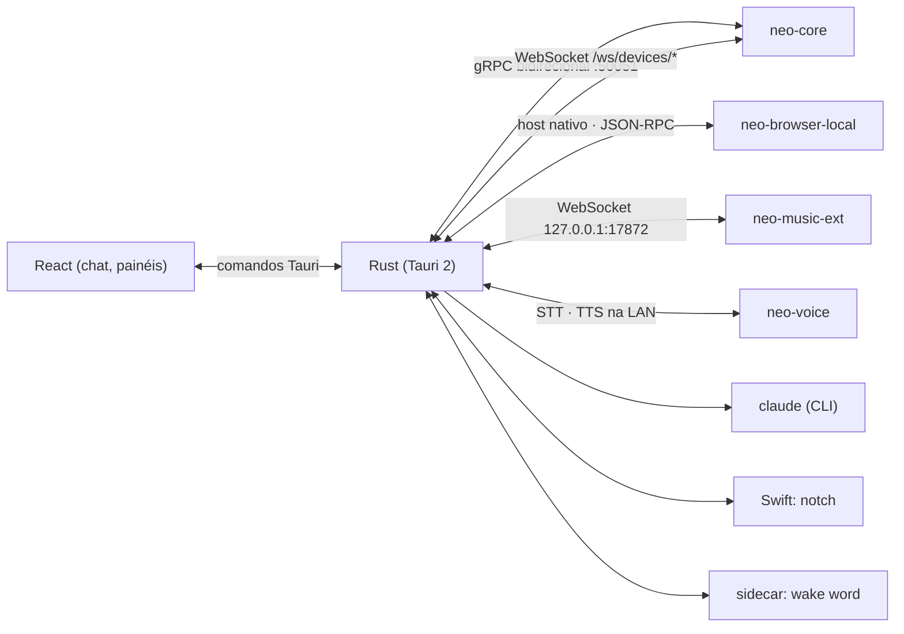

# neo-desktop-tauri

O app do Neo no Mac. É o único cliente que **executa coisas na máquina**: comandos no terminal, arquivos locais, o navegador do usuário e o Claude Code. Também cuida da voz: wake word, modo live e o "notch" nativo.

## Como conversa com o resto



## Onde fica cada coisa

| Caminho | O que tem |
|---|---|
| `src/` | Interface em React: chat com streaming, planos, jobs, caderno, arquivos locais, ajustes de voz |
| `src-tauri/src/services/shell.rs`, `command_policy.rs` | Execução de comandos no Mac e a política de risco: o que roda sozinho e o que pede confirmação |
| `src-tauri/src/services/browser_local.rs` | Ponte com o navegador do usuário: snapshot da página, ações e conferência visual |
| `src-tauri/src/services/claude_cli.rs`, `claude_sessoes.rs` | Abre e acompanha sessões do Claude Code delegadas pelo core |
| `src-tauri/src/services/local_jobs.rs` | Comando lento vira tarefa local, com o resultado devolvido ao core no fim |
| `src-tauri/src/services/wake.rs`, `sidecar/wake/` | Wake word ("ei Neo") com openWakeWord, e o treino do modelo |
| `src-tauri/src/services/audio_route.rs` | Escolha de microfone e cancelamento de eco por rota de áudio |
| `src-tauri/macos/NeoNotchHost.swift` | O "notch": ilha nativa que mostra o estado do Neo e o modo live |
| `src-tauri/crates/neo-imagem/` | Marcações e recortes do print do navegador, numa crate separada para compilar otimizada em dev: de ~5 s para ~0,14 s por print Retina |

## Rodar e testar

```bash
npm install
npm start                          # compila o front e abre o tauri dev
cd src-tauri && cargo test         # 156 testes
```

O app espera o neo-core em `127.0.0.1:50051` (gRPC) e `:8000` (HTTP).
